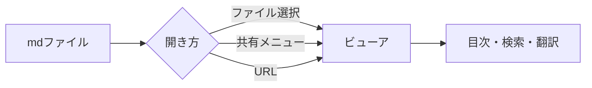

# Markdown Viewer サンプル

This is a test markdown document to verify the table of contents functionality.

## Introduction

This section introduces the test document and explains its purpose.

### Purpose

The purpose is to test the TOC generation and navigation features.

### Scope

This document covers various heading levels to test the TOC hierarchy.

## Main Content

Here we have the main content section with multiple subsections.

### Subsection A

This is subsection A with some content.

#### Deep Subsection 1

This is a deeper level heading.

##### Even Deeper

This is an even deeper heading level.

###### Deepest Level

This is the deepest heading level (h6).

### Subsection B

This is subsection B with different content.

#### Deep Subsection 2

Another deep subsection to test the TOC structure.

## Advanced Features

This section tests advanced markdown features.

### Code Blocks

Here's a code example:

```javascript
function testFunction() {
    console.log("Testing the extension");
}
```

### Lists

- Item 1
- Item 2
  - Nested item
  - Another nested item
- Item 3

### Tables

| Feature | Status |
|---------|--------|
| TOC Panel | ✅ Implemented |
| Click Navigation | ✅ Implemented |
| Scroll Spy | ✅ Implemented |
| Reading Progress | ✅ Implemented |

## 日本語の見出し

日本語の見出しでも目次からジャンプできます。[この見出しへのリンク](#日本語の見出し)や、[コードの行番号](#コードの行番号)のような文書内リンクも動きます。

### 同じ名前の見出し

同じ名前の見出しが複数あっても、IDが重ならないように番号が付きます。

### 同じ名前の見出し

こちらは2つ目です（ID は `同じ名前の見出し-1`）。

### コードの行番号

左端の番号は、元の Markdown ファイルの行番号です（VSCode と同じ番号）。右上の ⋮ メニューから表示を切り替えられます。コピーしても番号は含まれません。

```python
import json
from pathlib import Path


def load_articles(root: Path) -> list[dict]:
    """フォルダ内の Markdown 記事を読み込む"""
    articles = []
    for path in sorted(root.glob("**/*.md")):
        text = path.read_text(encoding="utf-8")
        title = next((l.lstrip("# ") for l in text.splitlines() if l.startswith("# ")), path.stem)
        articles.append({"path": str(path), "title": title, "chars": len(text)})
    return articles


if __name__ == "__main__":
    data = load_articles(Path("./posts"))
    print(json.dumps(data, ensure_ascii=False, indent=2))  # とても長い行は横スクロールしても行番号が左に固定されます。折り返しをオンにすると、ぶら下げインデントで表示されます。
```

### タスクリストと引用

- [x] 目次の作り直し
- [x] コードの行番号
- [ ] ページ内検索（フェーズ2）

> 引用ブロックの表示例です。

## リッチ表示

### 注記ボックス

> [!NOTE]
> GitHub と同じ書き方で注記ボックスになります。

> [!TIP]
> `> [!TIP]` はヒント、`[!IMPORTANT]` は重要、`[!WARNING]` は警告、`[!CAUTION]` は注意です。

> [!WARNING]
> 翻訳ボタン（文A）を押すと Gemini で文書全体を翻訳します。API キーは ⋮ メニューの「Gemini 翻訳の設定」で入力します。

### 数式

二次方程式 $ax^2 + bx + c = 0$ の解は次のとおりです。$5 と $10 のような金額は数式になりません。

$$
x = \frac{-b \pm \sqrt{b^2 - 4ac}}{2a}
$$

### 図（Mermaid）



### コードの色分け

```typescript
interface Article {
  title: string;
  tags: string[];
  /* 複数行の
     コメントも色分け */
  publishedAt?: Date;
}

export const slug = (a: Article): string =>
  a.title.toLowerCase().replace(/\s+/g, "-");
```

```hlsl
float4 PSMain(float4 pos : SV_POSITION, float2 uv : TEXCOORD0) : SV_TARGET
{
    return tex.Sample(samp, uv) * tint;
}
```

## Conclusion

This concludes our test document. The TOC should show all the headings in a hierarchical structure, and clicking on any TOC item should smoothly scroll to the corresponding section.

### Final Notes

- Test the toggle button to show/hide TOC
- Test the back-to-top button
- Test the reading progress bar
- Test theme switching with TOC visible
- Test responsive design on mobile

## Long Content Section

This section contains a lot of text to test the reading progress bar and scroll functionality. Lorem ipsum dolor sit amet, consectetur adipiscing elit. Sed do eiusmod tempor incididunt ut labore et dolore magna aliqua. Ut enim ad minim veniam, quis nostrud exercitation ullamco laboris nisi ut aliquip ex ea commodo consequat.

Duis aute irure dolor in reprehenderit in voluptate velit esse cillum dolore eu fugiat nulla pariatur. Excepteur sint occaecat cupidatat non proident, sunt in culpa qui officia deserunt mollit anim id est laborum.

Sed ut perspiciatis unde omnis iste natus error sit voluptatem accusantium doloremque laudantium, totam rem aperiam, eaque ipsa quae ab illo inventore veritatis et quasi architecto beatae vitae dicta sunt explicabo.

Nemo enim ipsam voluptatem quia voluptas sit aspernatur aut odit aut fugit, sed quia consequuntur magni dolores eos qui ratione voluptatem sequi nesciunt.

At vero eos et accusamus et iusto odio dignissimos ducimus qui blanditiis praesentium voluptatum deleniti atque corrupti quos dolores et quas molestias excepturi sint occaecati cupiditate non provident.

### More Content

Similique sunt in culpa qui officia deserunt mollitia animi, id est laborum et dolorum fuga. Et harum quidem rerum facilis est et expedita distinctio.

Nam libero tempore, cum soluta nobis est eligendi optio cumque nihil impedit quo minus id quod maxime placeat facere possimus, omnis voluptas assumenda est, omnis dolor repellendus.

Temporibus autem quibusdam et aut officiis debitis aut rerum necessitatibus saepe eveniet ut et voluptates repudiandae sint et molestiae non recusandae.

Itaque earum rerum hic tenetur a sapiente delectus, ut aut reiciendis voluptatibus maiores alias consequatur aut perferendis doloribus asperiores repellat.
